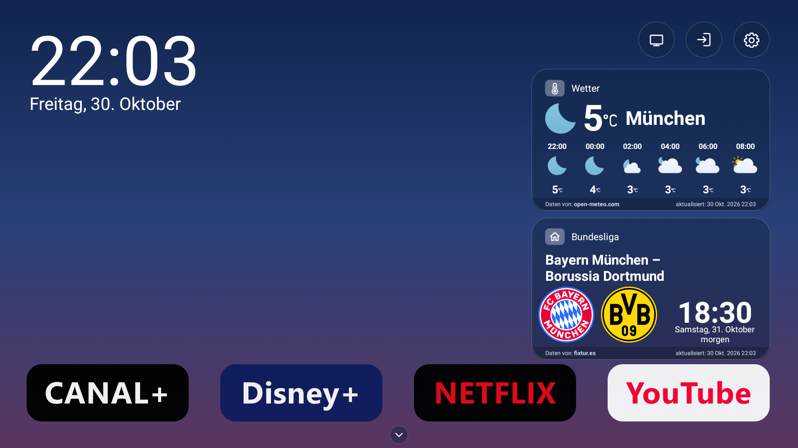
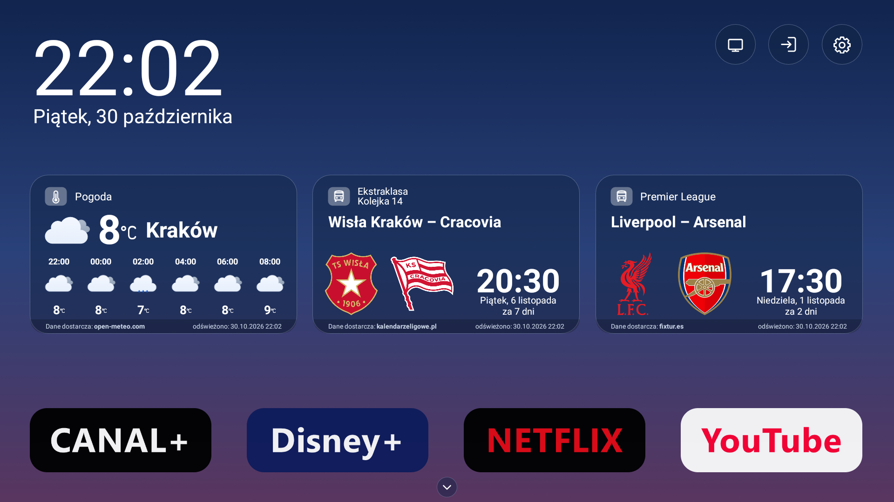

<p align="center">
  <picture>
    <source media="(prefers-color-scheme: dark)" srcset="docs/brand/linartv-header-dark.svg">
    
  </picture>
</p>

<p align="center">
  <a href="https://github.com/domlin92/linartv-launcher-open/releases/latest"></a>
  <a href="LICENSE"></a>
  
</p>

<p align="center"><a href="#english">English</a> · <a href="#polski">Polski</a></p>

<table align="center">
  <tr>
    <td align="center"><br><sub>One club · Jeden klub</sub></td>
    <td align="center"><br><sub>Two clubs · Dwa kluby</sub></td>
  </tr>
</table>

---

## English

**LinarTV** is a clean, fast home screen for Android TV built around Polish football. It shows the clock, the weather for your city and the next matches of one or two clubs you follow — and keeps your favourite apps one click away.

### Features
- **Your clubs' fixtures** — pick one or two teams from Ekstraklasa, I liga, II liga, any of the four III liga groups or any of the 16 IV liga groups on [kalendarzeligowe.pl](https://kalendarzeligowe.pl); fixtures update daily, with club crests.
- **Weather for any city in the world** — current conditions, hourly and 7-day forecast from Open-Meteo, with Meteocons weather icons.
- **Day and night modes**, app dock and full app drawer, quick access to TV inputs.
- **Polish or English interface** and Celsius or Fahrenheit temperature, selectable in LinarTV settings.
- **Wallpapers from your phone** — scan a QR code and upload photos over your home Wi-Fi (6-digit code, attempt limit).
- **Screensaver** with your photos after 5 minutes of inactivity.

### Install with Downloader (no computer needed)
**Downloader code: `1241090`** (or open `aftv.news/1241090`). It always installs the latest release.
1. On the TV, install **Downloader** by AFTVnews from the Play Store.
2. Open it and enter **1241090**.
3. Install the APK (allow *Install unknown apps* for Downloader when asked).
4. Open **LinarTV** from the apps row. To make it your home screen, see your TV's *Default home* / *Home screen* settings, or set it from a computer:
   ```text
   adb shell cmd package set-home-activity --user 0 io.github.domlin92.linartv.open/com.linart.tvpreview.DashboardActivity
   ```
   As the home screen, LinarTV opens after the TV starts and when it wakes from standby. On devices with plain Android (e.g. projectors) it is also listed among normal apps.

Or download `LinarTV.apk` directly from [Releases](https://github.com/domlin92/linartv-launcher-open/releases/latest).

### Install with an AI coding assistant (Codex, Claude Code)
Open this repository in Codex, Claude Code or a similar tool and ask, for example: *"Install LinarTV on my Android TV"* (give it the TV's IP address from the TV's network settings). The assistant follows [AGENTS.md](AGENTS.md): it checks the tools, builds or downloads the APK, connects with `adb`, installs the app and — only after asking you — sets it as the home screen, keeping the commands to restore the original launcher. Enable developer options and network debugging on the TV first (Settings → Device Preferences → About → click *Build* 7 times).

How it works and where the data comes from: [docs/FUNCTIONAL.md](docs/FUNCTIONAL.md) (in Polish, with UML diagrams).

### Build from source
JDK 17 and the Android SDK are required (`JAVA_HOME`, `ANDROID_HOME`).
```text
./gradlew :app:assembleDebug
```
Signed releases: see [docs/RELEASING.md](docs/RELEASING.md). What changed in each version: [CHANGELOG.md](CHANGELOG.md).

### Credits
- Inspired by and started inside [Clean Your TV](https://cleanyour.tv/) by Gathin (MIT).
- Fixtures: [kalendarzeligowe.pl](https://kalendarzeligowe.pl) — used with the site owner's permission.
- Foreign club fixtures (Top 5 leagues, domestic and European cups): match data by [fixtur.es](https://fixtur.es) — used under their fair-use rules; credited on every match card.
- Weather data: [Open-Meteo.com](https://open-meteo.com/) (CC BY 4.0); city search: Open-Meteo geocoding / GeoNames (CC BY 4.0).
- Weather icons: [Meteocons](https://github.com/basmilius/weather-icons) by Bas Milius (MIT), bundled in the app.
- Weather Icons font by Erik Flowers (SIL OFL 1.1) — used for the °C / °F sign.
- Club crests: [kalendarzeligowe.pl](https://kalendarzeligowe.pl); foreign clubs without a crest there: [football-logos.cc](https://football-logos.cc). Crests belong to their clubs — see [docs/CRESTS.md](docs/CRESTS.md).

### License
Code: [MIT](LICENSE). Club crests and third-party logos are not covered by the code license.

---

## Polski

**LinarTV** to czytelny, szybki ekran główny dla Android TV z myślą o polskiej piłce. Pokazuje zegar, pogodę dla Twojego miasta i najbliższe mecze jednego lub dwóch klubów — a ulubione aplikacje są zawsze pod ręką.

### Funkcje
- **Terminarz Twoich klubów** — wybierz jedną lub dwie drużyny z Ekstraklasy, I ligi, II ligi, dowolnej z czterech grup III ligi lub dowolnej z 16 grup IV ligi na [kalendarzeligowe.pl](https://kalendarzeligowe.pl); terminarze odświeżają się codziennie, z herbami klubów.
- **Pogoda dla dowolnego miasta na świecie** — aktualne warunki, prognoza godzinowa i 7-dniowa z Open-Meteo oraz ikony Meteocons. Miasto zmienisz w *Ustawieniach*.
- **Tryb dzienny i nocny**, pasek aplikacji i pełna lista aplikacji, szybki dostęp do źródeł TV.
- **Język polski lub angielski** oraz temperatura w stopniach Celsjusza lub Fahrenheita, wybierane w ustawieniach LinarTV.
- **Tapety z telefonu** — zeskanuj kod QR i wyślij zdjęcia przez domowe Wi-Fi (6-cyfrowy kod z limitem prób).
- **Wygaszacz** z Twoimi zdjęciami po 5 minutach bezczynności.

### Instalacja z asystentem AI (Codex, Claude Code)
Otwórz to repozytorium w Codex, Claude Code lub podobnym narzędziu i poproś np.: *„Zainstaluj LinarTV na moim telewizorze”* (podaj adres IP telewizora z jego ustawień sieci). Asystent korzysta z [AGENTS.md](AGENTS.md): sprawdza narzędzia, buduje lub pobiera APK, łączy się przez `adb`, instaluje aplikację i — dopiero po Twojej zgodzie — ustawia ją jako ekran główny, zapisując polecenia przywracające fabryczny launcher. Wcześniej włącz na TV opcje programisty i debugowanie sieciowe (Ustawienia → Ustawienia urządzenia → Informacje → 7× *Kompilacja*).

Opis działania i źródeł danych: [docs/FUNCTIONAL.md](docs/FUNCTIONAL.md) (z diagramami UML).

### Instalacja przez Downloader (bez komputera)
**Kod do Downloadera: `1241090`** (albo adres `aftv.news/1241090`). Zawsze instaluje najnowsze wydanie.
1. Na telewizorze zainstaluj **Downloader** (AFTVnews) ze Sklepu Play.
2. Otwórz go i wpisz **1241090**.
3. Zainstaluj APK (zezwól Downloaderowi na *instalowanie nieznanych aplikacji*).
4. Uruchom **LinarTV** z listy aplikacji. Aby ustawić go jako ekran główny, poszukaj w ustawieniach TV opcji *Domyślny ekran główny* albo ustaw go z komputera:
   ```text
   adb shell cmd package set-home-activity --user 0 io.github.domlin92.linartv.open/com.linart.tvpreview.DashboardActivity
   ```
   Jako ekran główny LinarTV otwiera się po włączeniu telewizora i po wybudzeniu z czuwania. Na urządzeniach ze zwykłym Androidem (np. projektory) widać go też na liście zwykłych aplikacji.

Plik `LinarTV.apk` możesz też pobrać bezpośrednio z [Releases](https://github.com/domlin92/linartv-launcher-open/releases/latest).

### Budowanie
Wymagane: JDK 17 i Android SDK (`JAVA_HOME`, `ANDROID_HOME`).
```text
./gradlew :app:assembleDebug
```
Podpisane wydania: [docs/RELEASING.md](docs/RELEASING.md). Zmiany w kolejnych wersjach: [CHANGELOG.md](CHANGELOG.md). Plan prac: [docs/ROADMAP.md](docs/ROADMAP.md).

### Podziękowania
- Projekt powstał na bazie i z inspiracji [Clean Your TV](https://cleanyour.tv/) (Gathin, MIT).
- Terminarze: [kalendarzeligowe.pl](https://kalendarzeligowe.pl) — za zgodą właściciela serwisu.
- Terminarze klubów zagranicznych (Top 5 lig, krajowe i europejskie puchary): dane meczowe [fixtur.es](https://fixtur.es) — na zasadach „fair use” fixtur.es; podpis na każdej karcie meczu.
- Dane pogodowe: [Open-Meteo.com](https://open-meteo.com/) (CC BY 4.0); wyszukiwanie miast: geokodowanie Open-Meteo / GeoNames (CC BY 4.0).
- Ikony pogody: [Meteocons](https://github.com/basmilius/weather-icons), Bas Milius (MIT), wbudowane w aplikację.
- Font Weather Icons: Erik Flowers (SIL OFL 1.1) — znak °C / °F.
- Herby: [kalendarzeligowe.pl](https://kalendarzeligowe.pl); kluby zagraniczne bez herbu tam: [football-logos.cc](https://football-logos.cc). Herby należą do klubów — zobacz [docs/CRESTS.md](docs/CRESTS.md).

### Licencja
Kod: [MIT](LICENSE). Herby klubów i logo innych firm nie są objęte licencją kodu.
