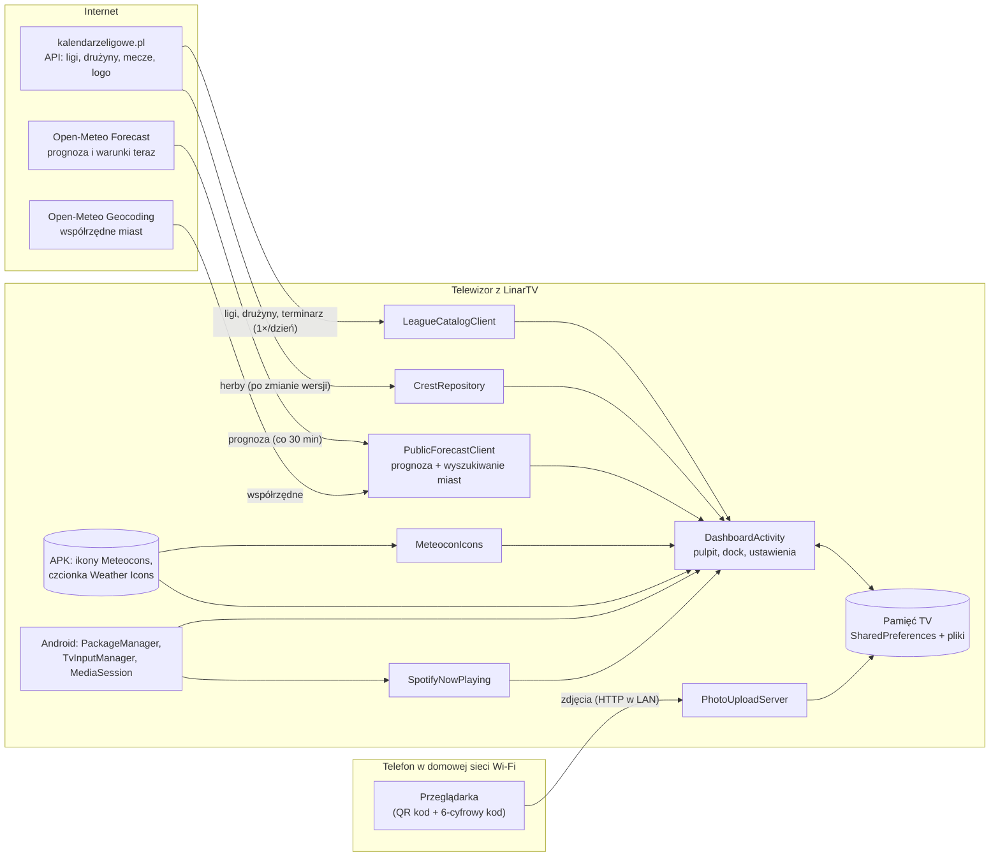
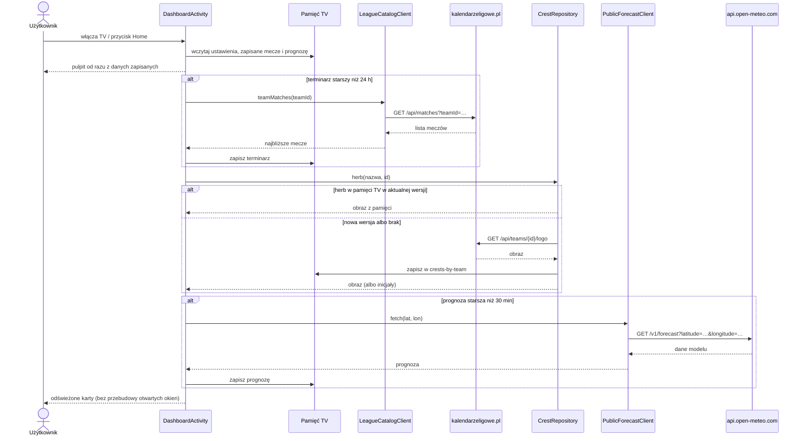

# LinarTV Open — dokumentacja funkcjonalna / Functional documentation

Wersja / Version 1.0.1 · Android TV 8.0+ (minSdk 26) · `io.github.domlin92.linartv.open`

[Polski](#polski) · [English](#english) · [Diagramy / Diagrams](#3-przepływ-danych-uml)

## Polski

LinarTV to ekran główny (launcher) dla Android TV z myślą o kibicach polskiej piłki. Wszystko dzieje się na jednym ekranie: zegar, pogoda, terminarze klubów, aplikacje i ustawienia, obsługiwane pilotem.

### 1. Funkcje

#### Pulpit
- **Zegar i data** w wybranym języku (polski, angielski, niemiecki, hiszpański lub włoski w wersji deweloperskiej).
- **Pogoda** dla wybranego miasta na świecie: bieżąca temperatura i prognoza godzinowa. Kliknięcie kafelka otwiera szczegóły: 7 dni, warunki teraz (wiatr, wilgotność, ciśnienie, opad), Słońce i fazę Księżyca. Dane odświeżają się co 30 minut. Wschód i zachód Słońca pochodzą z Open-Meteo, faza Księżyca jest liczona w aplikacji.
- **Terminarz jednego lub dwóch klubów** z Ekstraklasy, I ligi, II ligi, dowolnej grupy III ligi lub IV ligi (16 grup wojewódzkich). Karta pokazuje rozgrywki i kolejkę, rywala, herby, datę i godzinę (gdy jest potwierdzona) oraz czerwony **LIVE** w trakcie meczu. Kliknięcie karty przełącza między najbliższym a następnym meczem. Terminarze odświeżają się raz dziennie.
- **Układ:** przy dwóch klubach pogoda i dwie karty meczów stoją w jednym rzędzie. Przy jednym klubie pogoda i karta meczu są ułożone jedna nad drugą po prawej stronie.
- **Pasek narzędzi:** Oglądaj telewizję, Źródła (wejścia HDMI i tuner TV) oraz Ustawienia.

#### Dock i aplikacje
- Dock z ulubionymi aplikacjami pokazuje ich oryginalne banery. Przy mniej niż 4 aplikacjach kafelki są wyśrodkowane.
- **Przytrzymanie OK na kafelku** otwiera menu: Zamień aplikację, Przesuń (strzałki ◀ ▶ przestawiają kafelek, OK zapisuje, Wstecz anuluje), Edytuj cały dock, Usuń z docka.
- **Szuflada aplikacji**: strzałka w dół pod dockiem otwiera listę wszystkich aplikacji.
- **Odtwarzana muzyka:** gdy gra Spotify, pasek pokazuje tytuł utworu.

#### Ustawienia (zębatka)
| Kafelek | Co robi |
|---|---|
| Zamknij aplikacje | Prosi system o zamknięcie nieaktywnych aplikacji w tle; nie dotyka launchera ani usług systemowych |
| Tapety | Galeria tapet, w tym zdjęcia z telefonu przez QR kod i domowe Wi-Fi (6-cyfrowy kod, limit prób) |
| Wygaszacz | Pokaz Twoich zdjęć po wybranym czasie bezczynności (domyślnie 5 min) |
| Wygląd launchera | Automatycznie (dzień 08:00–19:59, noc 20:00–07:59), zawsze jasny, zawsze ciemny, własne godziny |
| Pogoda | Wybór miasta (dowolny kraj) i jednostki (°C lub °F) |
| Kalendarze | Kreator „Twoje kluby” (liga → klub, dla IV ligi liga → województwo → klub; jeden lub dwa) oraz „Odśwież teraz” |

Pod kafelkami: wolna pamięć RAM i miejsce na dysku, skrót do ustawień Android TV, Język, O aplikacji.

#### Pierwsze uruchomienie
Kreator prowadzi przez dwa kroki: „Twoje kluby”, a potem „Twoje aplikacje” (wybór docka spośród zainstalowanych aplikacji).

#### Ekran główny
LinarTV można ustawić jako domyślny ekran główny (ustawienie TV albo `adb shell cmd package set-home-activity`). Wtedy otwiera się po starcie telewizora (część TV najpierw włącza własne źródło) i po wybudzeniu z czuwania — pilnuje tego mała usługa z powiadomieniem „LinarTV · home screen”. Gdy LinarTV nie jest ekranem głównym, usługa się nie uruchamia. Na zwykłym Androidzie (np. projektory) aplikacja jest też na liście aplikacji.

### 2. Źródła danych

| Dane | Źródło | Jak często | Uwagi |
|---|---|---|---|
| Lista lig i drużyn | kalendarzeligowe.pl — API (`/api/seasons`, `/api/competitions`, `/api/competitions/{id}/standings`) | przy wyborze klubu | za zgodą właściciela serwisu |
| Terminarz klubu | kalendarzeligowe.pl — API (`/api/matches?teamId=`) | raz dziennie | w pamięci TV (SharedPreferences) |
| Kluby zagraniczne (Top 5) | fixtur.es — kanał iCal klubu `ics.fixtur.es/v2/{klub}.ics` (liga, krajowe i europejskie puchary); lista klubów wbudowana w aplikację | najwyżej co 6 godzin, z If-Modified-Since | podpis „Dane dostarcza: fixtur.es” na karcie meczu (warunek fixtur.es) |
| Herby | kalendarzeligowe.pl (`/api/teams/{id}/logo`) | ponownie tylko po zmianie wersji herbu (`crestVer`) | bez herbu pokazywane są inicjały; zob. [CRESTS.md](CRESTS.md) |
| Herby klubów zagranicznych | football-logos.cc (strony krajów, obrazki 256 px) | raz na klub, zapis w pamięci TV | tylko gdy kalendarzeligowe.pl nie ma herbu; dopasowanie po nazwie (`CrestNameMatcher`) |
| Prognoza i warunki teraz | Open-Meteo (`api.open-meteo.com/v1/forecast`, kody pogody WMO) | co 30 minut | CC BY 4.0, podpis „Open-Meteo.com” w szczegółach pogody |
| Ikony pogody | Meteocons (Bas Milius, MIT) — SVG wbudowane w APK (`assets/meteocons`) | zawsze | bez pobierania; działają bez sieci |
| Wyszukiwanie miasta | Open-Meteo Geocoding (GeoNames, CC BY 4.0), cały świat | przy wyborze miasta | wysyłana jest tylko wpisana nazwa |
| Aplikacje w docku i szufladzie | Android PackageManager (aplikacje Leanback) | przy starcie i zmianach | — |
| Źródła TV | Android TvInputManager / TvContract | na żądanie | wejścia HDMI i tuner |
| Odtwarzana muzyka | Android MediaSessionManager (sesja Spotify) | na bieżąco | wymaga zgody na dostęp do powiadomień |
| Zdjęcia z telefonu | wbudowany serwer HTTP w sieci lokalnej (PhotoUploadServer) | na żądanie | tylko domowa sieć Wi-Fi; kod jednorazowy z limitem prób |

Aplikacja nie ma konta użytkownika ani analityki. Do serwisów zewnętrznych trafiają tylko zapytania potrzebne do pobrania danych: współrzędne wybranego miasta, wpisana nazwa miasta i identyfikator drużyny. Ustawienia, terminarze, prognoza i pobrane obrazy są zapisane wyłącznie w pamięci telewizora.

### 3. Przepływ danych (UML)

#### Diagram komponentów

#### Diagram sekwencji: start pulpitu i odświeżanie danych

### 4. Zachowanie bez internetu
- Pulpit, dock, szuflada, źródła TV, tapety i wygaszacz działają w pełni.
- Terminarz i prognoza pokazują ostatnio zapisane dane wraz z godziną odświeżenia.
- Herby pokazują się, jeśli wcześniej zostały pobrane; w innym razie widać inicjały.
- Ikony pogody są wbudowane w aplikację, więc zawsze są widoczne.

### 5. Znane ograniczenia
- Darmowe API Open-Meteo jest przeznaczone do użytku niekomercyjnego; LinarTV pobiera prognozę najwyżej co 30 minut.
- Gdy kalendarzeligowe.pl nie podaje potwierdzonej godziny meczu, karta pokazuje sam dzień.
- Zamykanie aplikacji w tle zależy od systemu: Android może odmówić zamknięcia albo uruchomić aplikację ponownie.

---

## English

LinarTV is a home screen (launcher) for Android TV built for Polish football fans. Everything is on one screen and works with the remote: clock, weather, club fixtures, apps and settings.

### 1. Features

**Home screen**
- **Clock and date** in the selected language (Polish, English, German, Spanish or Italian in the development version).
- **Weather** for a chosen city anywhere in the world: current temperature and hourly forecast. Clicking the tile opens details: 7 days, current conditions (wind, humidity, pressure, precipitation), sun and moon phase. Refreshed every 30 minutes. Sunrise and sunset come from Open-Meteo; the moon phase is computed by the app.
- **Fixtures of one or two clubs** from Ekstraklasa, I liga, II liga, any III liga group or IV liga (16 regional groups). The card shows competition and round, opponent, crests, date and kick-off time (when confirmed) and a red **LIVE** during the match. Clicking the card switches between the next and the following match. Fixtures refresh once a day.
- **Layout:** with two clubs, weather and both match cards share one row; with one club, weather and the match card are stacked on the right.
- **Toolbar:** Watch TV, Inputs (HDMI and TV tuner) and Settings.

**Dock and apps**
- The dock shows favourite apps with their original banners; with fewer than 4 apps the tiles are centred.
- **Hold OK on a tile** for: Replace app, Move (◀ ▶ move the tile, OK saves, Back cancels), Edit the whole dock, Remove from dock.
- **App drawer:** the down arrow below the dock opens all apps.
- **Now playing:** while Spotify plays, the strip shows the track.

**Settings (gear)**

| Tile | What it does |
|---|---|
| Close apps | Asks Android to stop inactive background apps; never touches the launcher or system services |
| Wallpapers | Wallpaper gallery, including phone photos via QR code over home Wi-Fi (6-digit code, attempt limit) |
| Screensaver | Slideshow of your photos after the chosen idle time (5 min by default) |
| Launcher appearance | Automatic (day 08:00–19:59, night 20:00–07:59), always light, always dark, custom hours |
| Weather | City (any country) and unit (°C or °F) |
| Calendars | "Your clubs" wizard (league → club, for IV liga league → region → club; one or two) and "Refresh now" |

Below the tiles: free RAM and storage, a shortcut to Android TV settings, Language, About.

**First run:** a two-step wizard — "Your clubs", then "Your apps" (dock picked from installed apps).

**Home screen:** LinarTV can be the default home screen (TV setting or `adb shell cmd package set-home-activity`). It then opens after the TV starts (some TVs first switch to their own source) and after waking from standby, handled by a small service with the notification "LinarTV · home screen". When LinarTV is not the home screen the service does not run. On plain Android (e.g. projectors) the app is also listed among normal apps.

### 2. Data sources

| Data | Source | How often | Notes |
|---|---|---|---|
| Leagues and teams | kalendarzeligowe.pl API (`/api/seasons`, `/api/competitions`, `/api/competitions/{id}/standings`) | when choosing a club | used with the site owner's permission |
| Club fixtures | kalendarzeligowe.pl API (`/api/matches?teamId=`) | once a day | stored on the TV (SharedPreferences) |
| Foreign clubs (Top 5) | fixtur.es — the club's iCal feed `ics.fixtur.es/v2/{club}.ics` (league, domestic and European cups); club list bundled in the app | at most every 6 hours, with If-Modified-Since | credit "Data provided by: fixtur.es" on the match card (fixtur.es condition) |
| Crests | kalendarzeligowe.pl (`/api/teams/{id}/logo`) | again only when the crest version (`crestVer`) changes | initials when no image exists; see [CRESTS.md](CRESTS.md) |
| Foreign club crests | football-logos.cc (country pages, 256 px images) | once per club, cached on the TV | only when kalendarzeligowe.pl has no crest; matched by name (`CrestNameMatcher`) |
| Forecast and current conditions | Open-Meteo (`api.open-meteo.com/v1/forecast`, WMO weather codes) | every 30 minutes | CC BY 4.0, attribution "Open-Meteo.com" in weather details |
| Weather icons | Meteocons (Bas Milius, MIT) — SVG bundled in the APK (`assets/meteocons`) | always | no download; work offline |
| City search | Open-Meteo Geocoding (GeoNames, CC BY 4.0), worldwide | when choosing a city | only the typed name is sent |
| Dock and drawer apps | Android PackageManager (Leanback apps) | at start and on changes | — |
| TV inputs | Android TvInputManager / TvContract | on demand | HDMI inputs and tuner |
| Now playing | Android MediaSessionManager (Spotify session) | live | needs notification access |
| Phone photos | built-in local HTTP server (PhotoUploadServer) | on demand | home Wi-Fi only; one-time code with attempt limit |

No user account and no analytics. External services only receive what is needed to fetch data: the chosen city's coordinates, the typed city name and the team id. Settings, fixtures, forecast and downloaded images are stored only on the TV.

### 3. Data flow (UML)
See the component and sequence diagrams [above](#3-przepływ-danych-uml) — they apply to both languages.

### 4. Offline behaviour
- Home screen, dock, drawer, TV inputs, wallpapers and screensaver work fully.
- Fixtures and forecast show the last stored data with its refresh time.
- Crests appear if previously downloaded, otherwise initials.
- Weather icons are bundled in the app, so they are always shown.

### 5. Known limitations
- The free Open-Meteo API is meant for non-commercial use; LinarTV fetches the forecast at most every 30 minutes.
- When kalendarzeligowe.pl has no confirmed kick-off time, the card shows the day only.
- Closing background apps depends on the system: Android may refuse or restart them.
